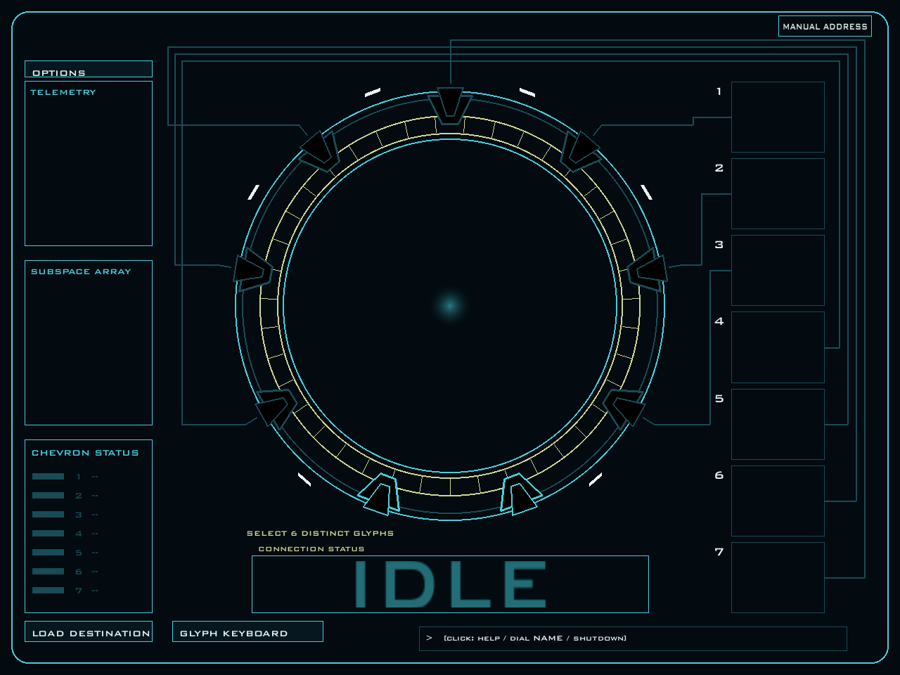
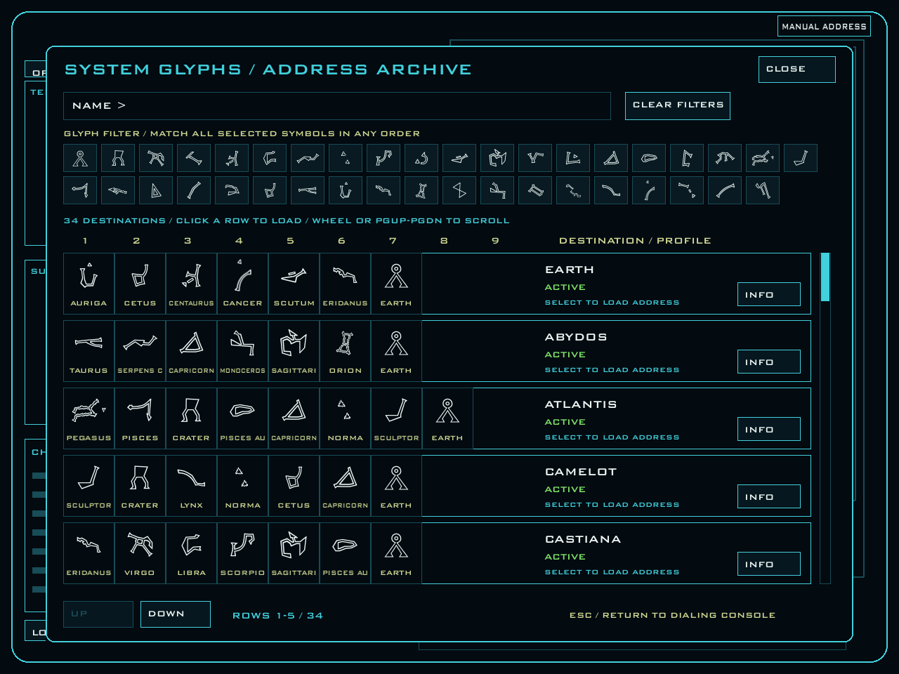

# Stargate Dialer

A desktop Stargate dialing simulator built with Python and pygame-ce. It includes
an SGC-style console, a separate glyph keyboard, 7–9-symbol addresses, computer
and DHD dialing, synchronized sound, and an animated iris.



## Run from source

Requires Python 3.14 or newer. From the project directory, install the locked
environment and launch with [uv](https://docs.astral.sh/uv/):

```sh
uv sync --locked
uv run main.py
```

Alternatively, create a virtual environment and install the project dependencies:

```sh
python -m venv .venv
```

On Linux or macOS:

```sh
.venv/bin/python -m pip install "pygame-ce>=2.5.7" "setuptools==83.0.0"
.venv/bin/python main.py
```

On Windows PowerShell:

```powershell
.\.venv\Scripts\python.exe -m pip install "pygame-ce>=2.5.7" "setuptools==83.0.0"
.\.venv\Scripts\python.exe main.py
```

Assets resolve relative to the source files. The main window resizes with
letterboxing to preserve its 1280 × 960 layout.

## Console and glyph keyboard

Click **GLYPH KEYBOARD** to open the separate resizable keyboard window. It starts
hidden; closing it hides the keyboard without exiting the simulator. The main
console contains the gate, address slots, diagnostics, status, command field,
**OPTIONS**, and **LOAD DESTINATION**.

The keyboard provides Earth (0), destination glyphs 1–38, **7 SYM / 8 SYM /
9 SYM**, **UNDO**, **CLEAR**, **ACTIVATE**, **SHUTDOWN / ESC**, **IRIS**, and the
**DHD** toggle, and **SPEED** button. Hover over a destination glyph to see its name.

Across the keyboard, Options, and archive, selected controls use a green outline
and fill. Hover brightens an available control; disabled controls use muted text
and do not respond to hover or clicks. Selected settings stay visibly marked
when temporarily locked. Button labels are centered and fitted to their bounds.

Address length includes the final Earth Point of Origin:

| Mode | Distinct destination glyphs | Total symbols |
| --- | --- | --- |
| 7 SYM | 6 | 7 |
| 8 SYM | 7 | 8 |
| 9 SYM | 8 | 9 |

Changing length clears the current entry. Atlantis and Othala use eight symbols;
Destiny uses nine. Earth always locks last at the top chevron. Extra destination
chevrons occupy the lower positions; slots, diagnostics, and lock sounds follow
the selected length.

### Computer dialing (default)

Select the destination glyphs in order, then click **ACTIVATE** or press Enter.
Earth can be selected explicitly after the destination glyphs; activation also
adds it automatically in computer mode. **UNDO** or Backspace removes Earth first
if selected, otherwise the last destination glyph. Input is frozen during dialing.

The ring alternates direction and cruises at 5 RPM by default. Use
`uv run main.py --rpm 8` to select another positive speed. The keyboard's **SPEED**
button cycles through **5 → 10 → 15 → 5 RPM** without clearing the loaded address.
It is available while idle or after a failed attempt and disabled during dialing
and gate animations. One RPM setting applies
to computer dialing, DHD queue/resume, ring rendering, and abort braking; encoding
and audio timing follow the same motion calculation. Acceleration and braking
ramps last up to 1.5 seconds, shortened for fast moves with insufficient travel. Travel time depends on the angular distance to each symbol.
Each stop includes a 2.8-second encoding and lock interval. The glyph moves from
the top chevron to the center, pauses, then shrinks into its address slot.

### DHD dialing

Toggle **DHD** in the glyph keyboard while idle or after a failed attempt.
The enabled toggle has a green outline and fill.
Changing behavior clears the entry. The toggle is disabled during encoding,
waiting for more input or activation, connection, braking, and closure.

Each glyph click immediately starts or queues encoding. If the queue runs out,
the ring pauses until another glyph is selected. After all destination glyphs,
select **EARTH / ORIGIN** to queue the final chevron.

**ACTIVATE** or Enter requests a connection once every symbol has been selected.
It can be pressed while encoding continues. After the final lock, activation
plays the DHD dial cue and waits 0.8 seconds before resolving the destination.
With Atlantis button sounds, the activation cue plays on the initial activation
request instead. Without an activation request, the fully encoded gate stays
**READY**. Shutdown cancels pending activation.

### Connections and shutdown

A successful connection displays **ACTIVE**, a green OK indicator per locked
symbol, a procedural blue event horizon, and a 38-minute countdown. The timer
starts when the connection is established and automatically disengages at expiry.

Unknown, restricted, and inactive addresses play the failure cue and immediately
reset the gate to **IDLE**, clearing the address and chevrons. The failure reason
remains in the message line, and a new address can be entered immediately.
**SHUTDOWN / ESC** or Escape aborts dialing or closes a connection;
the console animates braking or closure as appropriate.

## Address archive

Click **LOAD DESTINATION** while the gate is idle and its visual transitions have
finished. Search by destination name and/or select glyph filters. All selected
filters must occur in the address, in any order; the loaded address retains its
original order.

Scroll using the mouse wheel, Page Up/Page Down, the scrollbar, or **UP / DOWN**.
Click a destination row to load it, or **INFO** to inspect its address, eligibility,
and profile fields. **LOAD ADDRESS** loads from the information view. Escape
returns from information to results, then closes the archive.

Loading selects the correct address length and includes Earth. In computer mode
it fills the entry for activation; in DHD mode it queues encoding immediately,
and activation must still be requested. Restricted and inactive destinations
remain selectable for failed-connection scenarios. Console menus block keyboard
window input until closed.



## Commands and shortcuts

Click the command field, type a command, and press Enter. Commands and destination
names are case-insensitive; names containing spaces can be entered directly or
surrounded by matching quotes.

| Command | Behavior |
| --- | --- |
| `start` | Activate the current entry, like the keyboard ACTIVATE button. |
| `dial <destination name>` | Load and start a named destination, e.g. `dial Atlantis` or `dial Martin Lloyd's Homeworld`. In DHD mode, also queue activation. Busy gates reject replacement addresses. |
| `shutdown` or `abort` | Abort dialing or close the connection. |
| `reset` | Clear entry while idle or after failure. |
| `iris` | Toggle the iris. |
| `iris open` / `iris close` | Set the iris target. |
| `help` | Display the supported command summary. |

Bare `dial` displays usage. Enter outside the command field, or with an empty
command field, operates ACTIVATE. Backspace outside the command field operates
UNDO. Escape aborts or shuts down; in a console menu it closes the current menu
or information view. These shortcuts also work in the glyph keyboard when no
console menu is open.

## Iris and options

**IRIS** on the glyph keyboard toggles the aperture independently of dialing and
connection state. It stays in its chosen position after shutdown. Opening and
closing use independent audio and match the sound duration. Repeating the current
target does not replay the sound; reversing motion preserves the aperture size.

**OPTIONS** contains uniform glyph sizing, classic / Atlantis / silent glyph
press sounds, and computer encoding sound controls. Silent glyph press mode
suppresses individual glyph clicks; activation retains its separate dial cue.
DHD behavior is controlled in the keyboard window.

The **MASTER VOLUME** slider adjusts all keyboard, gate, computer, and iris
sounds immediately, including loops already playing. Click or drag to select
0–100%; 0% mutes all audio. Volume defaults to 100% at launch and applies for
the current session.

## Project structure

`main.Console` initializes the application, coordinates gate effects and shared
actions, and routes the main event loop. It composes these UI components:

| Module | Responsibility |
| --- | --- |
| `keyboard_window.py` | Glyph keyboard window lifecycle, local state, layout, and input. |
| `address_archive.py` | Archive state, filtering, scrolling, destination information, and input. |
| `options_menu.py` | Options menu rendering and interaction. |
| `console_commands.py` | Parsing and dispatching console commands. |
| `console_renderer.py` | Main console drawing, telemetry, glyph placement, and visual effects. |
| `drawing_context.py` | Window-local canvas, font cache, mouse position, drawing helpers, and button hit targets. |
| `view_state.py` | Explicit gate-animation state, UI settings, and command-input state. |
| `ui_geometry.py` | Shared dimensions, palette, and gate geometry. |
| `ring_motion.py` | Shared default RPM, acceleration ramps, symbol travel durations, and ring position/velocity. |

UI components receive their resources and action callbacks through keyword-only
constructor arguments; they do not receive a `Console` reference. The main window
and glyph keyboard have separate `DrawingContext` instances, so keyboard rendering
never replaces the main window's canvas or input targets. The renderer owns its
cached gate frame, event horizon, and slot sizing resources.

Code using the UI should call the owning component directly, for example
`app.renderer.draw(now)`, `app.keyboard.open_keyboard()`, and
`app.commands.execute_command(now)`. Drawing state is under `app.ui`, animation
state under `app.visual`, settings under `app.settings`, and command text/focus
under `app.input`. The former Console compatibility properties and forwarding
methods have been removed. The `Dialer` interface and user controls are unchanged.

`simulator.Dialer` is the public simulation interface used by the UI and audio.
Its supporting modules have no Pygame dependency:

| Module | Responsibility |
| --- | --- |
| `dialing_states.py` | Encoding progress and computer/DHD state transitions. |
| `address_validation.py` | Glyph entry rules, ordered address matching, and destination eligibility. |
| `dhd_queue.py` | Incremental encoding and pause/resume timeline management. |
| `activation.py` | Activation requests, post-lock delay, and one-shot sound notifications. |
| `connection.py` | Connection start time, remaining lifetime, and expiration. |

The cycle clock stays in `simulator.py` so encoding, ring motion, and audio share
timing. `gate_audio.py` coordinates gate, computer, and iris channels; `iris.py`
implements aperture motion and drawing; `glyph.py` renders the bundled glyph font.
`glyph_database.address_database` is authoritative. Legacy `address_list` is
retained for compatibility and is not used for destination resolution.

## Verification

Run all tests and generate an off-screen connected-state screenshot:

```sh
uv run python -m unittest discover -v
uv run main.py --preview connected.png
```

For headless Linux verification:

```sh
SDL_VIDEODRIVER=dummy SDL_AUDIODRIVER=dummy uv run python -m unittest discover -v
SDL_VIDEODRIVER=dummy SDL_AUDIODRIVER=dummy uv run main.py --preview connected.png
```

The existing virtual environment's Python can be used instead of `uv run`.
The GitHub Actions workflow `.github/workflows/headless-tests.yml` runs the entire
test suite and a preview smoke test on pushes, pull requests, and manual runs.
After the tests pass, it builds and smoke-tests Windows and Linux executables.
It uses Python 3.14, locked dependencies from `uv.lock`, and SDL dummy video/audio
drivers.
Screenshots are in `previews/`; visual references are in `reference/`.

## Windows and Linux executables

The **Tests and builds** GitHub Actions workflow creates these downloads after
the headless tests pass:

| Artifact | Contents | Build host |
| --- | --- | --- |
| `StargateDialer-windows-x64` | `StargateDialer-windows-x64.zip`, containing `StargateDialer.exe` | Windows x64 |
| `StargateDialer-linux-x64` | `StargateDialer-linux-x64.tar.gz`, containing `StargateDialer` | Ubuntu 22.04 x64 |

Open a successful run in the repository's **Actions** tab and download the desired
artifact. Extract the included archive; the Linux tar archive preserves executable
permissions. Artifacts are retained for 14 days. Each executable is built on its
own operating system and must be run on that platform. Linux builds target Ubuntu
22.04 or compatible newer distributions and require desktop graphics/audio system
libraries. Python does not need to be installed on the target machine.

Both builds run the packaged executable with `--preview` before uploading it,
checking that the bundled runtime, imports, fonts, and rendering assets load.
A failed preview prevents uploading that platform's artifact.

`StargateDialer.spec` defines a single-file native build containing the Python
runtime, pygame-ce libraries, both bundled fonts, and `media/`. Tests, reference
images, virtual environments, and IDE files are excluded.

Build on either operating system from the project directory with uv:

```sh
uv sync --locked
uv run --locked --with-requirements requirements-build.txt python -m PyInstaller --noconfirm --clean StargateDialer.spec
```

The local output is `dist/StargateDialer` on Linux or `dist/StargateDialer.exe` on
Windows. Test a Linux build without opening the GUI:

```sh
SDL_VIDEODRIVER=dummy SDL_AUDIODRIVER=dummy ./dist/StargateDialer --preview /tmp/connected.png
```

The existing Windows PowerShell helper is also available after setting up the environment:

```powershell
.\.venv\Scripts\python.exe -m ensurepip --upgrade
.\.venv\Scripts\python.exe -m pip install -r requirements-build.txt
.\build.ps1
```

The result is `dist\StargateDialer.exe`. Copy it to another Windows x64 PC;
Python does not need to be installed there. One-file builds extract their runtime
and assets to a temporary directory at launch. The executable is not code-signed.
Rebuild after changing code, destination data, or assets.

Use `build.ps1 -OutputDirectory <path>` to select another output folder. Check the
packaged renderer with:

```powershell
.\dist\StargateDialer.exe --preview connected.png
```

## Credits

The glyph font `stargate_sg1_adress_glyphs.ttf` is by Joy Anne Baker, from
[The SciFi World's font collection](https://www.thescifiworld.net/fonts.htm).
Sounds come from a fork of RafaelDeJongh's Carter's Addon pack for Garry's Mod.
Stargate materials and brand copyright belong to Amazon and MGM Studios.

ChatGPT's Codex assisted with generating the Pygame code. The interface and event
horizon are drawn procedurally with Pygame and inspired by the supplied reference
photographs. No external artwork, sound effects, or voices were generated through
ChatGPT.
