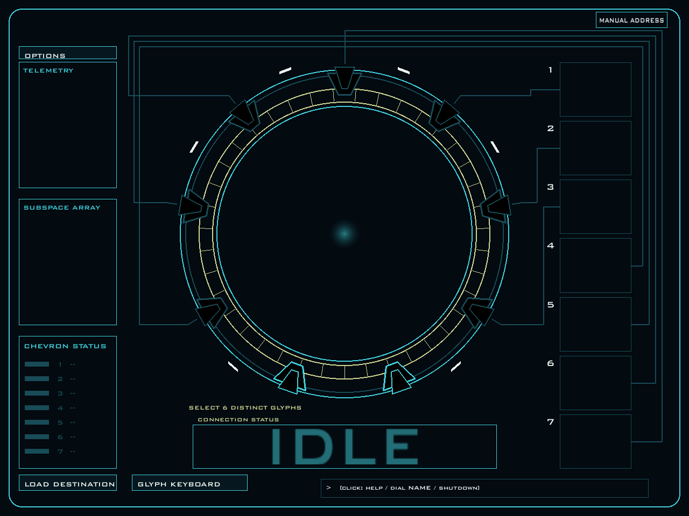
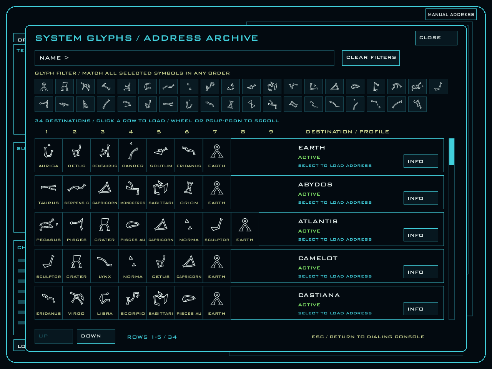

# Stargate Dialer

A desktop Stargate dialing simulator built with Python and pygame-ce. It includes
an SGC-style console, a separate glyph keyboard, 7–9-symbol addresses, computer
and DHD dialing, synchronized sound, and an animated iris.



## Run from source

Requires Python 3.14 or newer. From the project directory, install the locked
environment and launch with [uv](https://docs.astral.sh/uv/):

```sh
uv sync --locked
uv run main.py
```

Alternatively, create a virtual environment and install the project dependencies:

```sh
python -m venv .venv
```

On Linux or macOS:

```sh
.venv/bin/python -m pip install "pygame-ce>=2.5.7" "setuptools==83.0.0" "av>=19.0.2,<20"
.venv/bin/python main.py
```

On Windows PowerShell:

```powershell
.\.venv\Scripts\python.exe -m pip install "pygame-ce>=2.5.7" "setuptools==83.0.0" "av>=19.0.2,<20"
.\.venv\Scripts\python.exe main.py
```

Assets resolve relative to the source files. The main window resizes with
letterboxing to preserve its 1280 × 960 layout.

## Console and glyph keyboard

Click **GLYPH KEYBOARD** to open the separate resizable keyboard window. It starts
hidden; closing it hides the keyboard without exiting the simulator. The main
console contains the gate, address slots, diagnostics, status, command field,
**OPTIONS**, and **LOAD DESTINATION**.

The keyboard uses a 1280 × 300 layout with spaced control groups and glyph rows;
resizing scales both the display and its click targets together.

The keyboard provides Earth (0), destination glyphs 1–38, **7 SYM / 8 SYM /
9 SYM**, **UNDO**, **CLEAR**, **ACTIVATE**, **SHUTDOWN / ESC**, **IRIS**, and the
**DHD** toggle, and **SPEED** button. Hover over a destination glyph to see its name.

Across the keyboard, Options, and archive, selected controls use a green outline
and fill. Hover brightens an available control; disabled controls use muted text
and do not respond to hover or clicks. Selected settings stay visibly marked
when temporarily locked. Button labels are centered and fitted to their bounds.

Address length includes the final Earth Point of Origin:

| Mode | Distinct destination glyphs | Total symbols |
| --- | --- | --- |
| 7 SYM | 6 | 7 |
| 8 SYM | 7 | 8 |
| 9 SYM | 8 | 9 |

Changing length clears the current entry. Atlantis and Othala use eight symbols;
Destiny uses nine. Earth always locks last at the top chevron. Extra destination
chevrons occupy the lower positions; slots, diagnostics, and lock sounds follow
the selected length.

### Computer dialing (default)

Select the destination glyphs in order, then click **ACTIVATE** or press Enter.
Earth can be selected explicitly after the destination glyphs; activation also
adds it automatically in computer mode. **UNDO** or Backspace removes Earth first
if selected, otherwise the last destination glyph. Input is frozen during dialing.

The ring alternates direction and cruises at 5 RPM by default. Use
`uv run main.py --rpm 8` to select another positive speed. The keyboard's **SPEED**
button cycles through **5 → 10 → 15 → 5 RPM** without clearing the loaded address.
It is available while idle or after a failed attempt and disabled during dialing
and gate animations. One RPM setting applies
to computer dialing, DHD queue/resume, ring rendering, and abort braking; encoding
and audio timing follow the same motion calculation. Acceleration and braking
ramps last up to 1.5 seconds, shortened for fast moves with insufficient travel. Travel time depends on the angular distance to each symbol.
Each stop includes a 2.8-second encoding and lock interval. The glyph moves from
the top chevron to the center, pauses, then shrinks into its address slot.

### DHD dialing

Toggle **DHD** in the glyph keyboard while idle or after a failed attempt.
The enabled toggle has a green outline and fill.
Changing behavior clears the entry. The toggle is disabled during encoding,
waiting for more input or activation, connection, braking, and closure.

Each glyph click immediately starts or queues encoding. If the queue runs out,
the ring pauses until another glyph is selected. After all destination glyphs,
select **EARTH / ORIGIN** to queue the final chevron.

**ACTIVATE** or Enter requests a connection once every symbol has been selected.
It can be pressed while encoding continues. After the final lock, activation
plays the DHD dial cue and waits 0.8 seconds before resolving the destination.
With Atlantis button sounds, the activation cue plays on the initial activation
request instead. Without an activation request, the fully encoded gate stays
**READY**. Shutdown cancels pending activation.

### Connections and shutdown

A successful connection displays **ACTIVE**, a green OK indicator per locked
symbol, a procedural blue event horizon, and an elapsed-time display counting up
from **00:00** when the connection opens. Automatic closure still occurs after
38 minutes by default. The **RANDOM DURATION** toggle in Options adds a randomly
chosen **5–45 seconds** to each new connection's lifetime. It defaults to off;
changing it affects the next connection, not one already open.

Unknown, restricted, and inactive addresses play the failure cue and immediately
reset the gate to **IDLE**, clearing the address and chevrons. The failure reason
remains in the message line, and a new address can be entered immediately.
Dialing the current planet's own address (such as Earth from SGC or Abydos from
Abydos) is treated as an invalid address and follows the same reset behavior.
**SHUTDOWN / ESC** or Escape aborts dialing or closes a connection;
the console animates braking or closure as appropriate.

## Planet themes and offworld DHD framework

Earth remains the default console. Dial Abydos, wait for a successful connection,
then click **TRAVEL** to arrive. Arrival switches to the local theme while
preserving the open connection at both ends. After a 1.5-second grace period,
both gates shut down together. Manual shutdown during that period closes both
early; travel does not replay opening audio. Connecting alone never changes location.

Arrival gates show an incoming connection with empty address slots and unselected
DHD keys. The departure address stays at its source and is not shown during the
arrival gate's shutdown fade. A fresh local entry restores normal address display.
Offworld gates show a cached static gate image and glyph slots without telemetry, iris,
ring motion, or flying glyph animations. The event horizon still opens and closes.
The gate has layered metallic bands, engraved track panels, inner vents, and
ribbed V-shaped chevrons with recessed jewels that illuminate as symbols lock.
The gate image is drawn procedurally; the reference photographs are not bundled
as game artwork.

The offworld keyboard has two rings of 19 wedge buttons and a central red
**ACTIVATE** dome. Each glyph press lights its button immediately, then encodes
its slot and engages its chevron after a short 0.2-second delay. Rapid presses
queue in order; shutdown cancels pending engagements. Select destination
glyphs, the local origin last, then activate. Length controls support 7–9-symbol
addresses on Earth; offworld DHDs are restricted to seven symbols, with the
address-mode controls hidden and longer address loads rejected. Arrival offworld
also restores seven-symbol mode. To return, enter Earth's address **27, 25, 4, 35, 10, 28**, followed by
the local origin and Activate, then **TRAVEL** after connecting. Hover/click areas
follow each wedge rather than rectangular bounding boxes.

Computer encoding cues are suppressed offworld; DHD button and gate sounds remain
active. Returning to Earth restores the existing computer-sound preference.
One continuous roll loop starts on the first glyph without restarting on later
presses, and stops as soon as the final chevron engages (or on failure/shutdown).
Offworld engagement uses `chev_usual_1.wav` through `chev_usual_7.wav` in shuffled
sets: every clip plays once before reshuffling, with no immediate repeat across
sets. Earth retains its original chevron sounds.
The offworld DHD's **SGC DIALING** toggle defaults off and can be changed while
idle. When enabled, glyph presses queue while the ring rotates and chevrons lock
in order, using the SGC console's DHD queue and timing. The ring pauses when the
queue runs out and resumes with the next press. After entering the complete
address and origin, the dome can queue activation before the final lock. The frame and
chevrons stay fixed. Offworld computer encoding sounds remain disabled.
Selected glyph buttons have orange outlines matching their symbols. The central
dome activates a complete address and serves as Shutdown while connected or
during an unfinished dialing sequence; there is no separate Shutdown button.
During SGC-style offworld dialing, shutdown brakes the ring to a nearby tile
center, stops the roll, then plays `dial_fail_sg1.mp3` once. Instant dialing
stops immediately and plays the same failure cue when an entry is interrupted.
Closing an established connection or stopping an idle gate does not play that cue.
Offworld slot glyphs and DHD selection lights fade together during shutdown.
This uses one offworld fade timeline; after closure, new entry is immediately
available and interrupts the lingering lights. The offworld DHD has no Undo or
Clear buttons; use the center dome to cancel an unfinished entry.
The lights linger for 0.6 seconds after connection closure or ring braking, then
fade over two seconds. Starting a fresh entry clears any remaining selection fade.
The offworld **SPEED / RPM** button uses the same speed cycle as the SGC keyboard.
It is enabled only with **SGC DIALING** on, while the gate is idle and transitions
have finished. Hover labels appear below these controls.

`themes.py` owns immutable planet profiles: background, DHD tint/style, local
origin artwork, keyboard inventory, and a reserved ambient-sound path. DHD RGB
channels stay within ±24 of the shared base `(82, 79, 69)`. Supported styles are
`weathered-stone` and `smooth-metal`. Ambient playback is deferred.

The 38-button requirement includes the origin, so each offworld profile replaces
one of the 38 shared glyphs. `omitted_glyph` is configurable; the initial Abydos
profile omits glyph 12 (Aquila), matching the configured 19+19 arrangement.
Both ring orders are defined clockwise from twelve o'clock in `themes.py`;
the local origin occupies the sixteenth outer-ring position.
Addresses containing that omitted glyph are rejected when loaded or entered.
Internal ID 0 means local origin; Abydos renders glyph 39 (font character `n`),
while Earth retains its bundled origin glyph. Add origin artwork in `glyph.py`
and its validated key in `PlanetTheme` when introducing further planets.
Register profiles in `PLANET_THEMES`; **TRAVEL** is enabled only for registered
destinations. Earth and Abydos are the initial supported locations.

Preview without travelling:

```powershell
.\.venv\Scripts\python.exe main.py --abydos
.\.venv\Scripts\python.exe main.py --theme abydos --preview previews/abydos-gate.png
.\.venv\Scripts\python.exe main.py --theme abydos --keyboard-preview previews/abydos-dhd.png
```

`--abydos` launches directly on Abydos with the offworld DHD hidden; it is a shortcut
for `--theme abydos`. Packaged builds also accept `StargateDialer.exe --abydos`.
Arrival offworld also hides the DHD. Click **GLYPH KEYBOARD** to open it manually.

## Address archive

Click **LOAD DESTINATION** while the gate is idle and its visual transitions have
finished. Search by destination name and/or select glyph filters. All selected
filters must occur in the address, in any order; the loaded address retains its
original order.

Scroll using the mouse wheel, Page Up/Page Down, the scrollbar, or **UP / DOWN**.
Click a destination row to load it, or **INFO** to inspect its address, eligibility,
and profile fields. **LOAD ADDRESS** loads from the information view. Escape
returns from information to results, then closes the archive.

Loading selects the correct address length and includes Earth. In computer mode
it fills the entry for activation; in DHD mode it queues encoding immediately,
and activation must still be requested. Restricted and inactive destinations
remain selectable for failed-connection scenarios. Console menus block keyboard
window input until closed.



## Commands and shortcuts

Click the command field, type a command, and press Enter. Commands and destination
names are case-insensitive; names containing spaces can be entered directly or
surrounded by matching quotes.

| Command | Behavior |
| --- | --- |
| `start` | Activate the current entry, like the keyboard ACTIVATE button. |
| `dial <destination name>` | Load and start a named destination, e.g. `dial Atlantis` or `dial Martin Lloyd's Homeworld`. In DHD mode, also queue activation. Busy gates reject replacement addresses. |
| `shutdown` or `abort` | Abort dialing or close the connection. |
| `reset` | Clear entry while idle or after failure. |
| `iris` | Toggle the iris. |
| `iris open` / `iris close` | Set the iris target. |
| `help` | Display the supported command summary. |

Bare `dial` displays usage. Enter outside the command field, or with an empty
command field, operates ACTIVATE. Backspace outside the command field operates
UNDO. Escape aborts or shuts down; in a console menu it closes the current menu
or information view. These shortcuts also work in the glyph keyboard when no
console menu is open.

## Iris and options

**IRIS** on the glyph keyboard toggles the aperture independently of dialing and
connection state. It stays in its chosen position after shutdown. Opening and
closing use independent audio and match the sound duration. Repeating the current
target does not replay the sound; reversing motion preserves the aperture size.

**OPTIONS** contains uniform glyph sizing, classic / Atlantis / silent glyph
press sounds, and computer encoding sound controls. Silent glyph press mode
suppresses individual glyph clicks; activation retains its separate dial cue.
DHD behavior is controlled in the keyboard window.

The **MASTER VOLUME** slider adjusts all keyboard, gate, computer, and iris
sounds immediately, including loops already playing. Click or drag to select
0–100%; 0% mutes all audio. Volume defaults to 100% on first launch and is
remembered for subsequent sessions.

## Remembered settings

Preferences restore automatically at startup and save quietly after changes and
on normal exit. This includes volume, sound choices, glyph sizing, randomized
duration, dialing mode, speed, symbol count, offworld SGC dialing, and video file,
enablement, and timestamps. Video playback starts disabled on a fresh setup;
enabling it explicitly is remembered. An explicit `--rpm` overrides the saved speed.

Settings are stored in `%LOCALAPPDATA%\StargateDialer\settings.json` on Windows,
`~/.config/stargate-dialer/settings.json` on Linux (or `$XDG_CONFIG_HOME`), and
`~/Library/Application Support/StargateDialer/settings.json` on macOS. Writes are
debounced and atomic; missing, invalid, or unwritable files never trigger dialogs
or prevent startup. Delete the file to restore defaults. Active connections and
entered addresses are not restored. Preview commands do not read or save preferences.

## Custom event-horizon videos

Open **OPTIONS → EVENT HORIZON VIDEO**, choose **SELECT VIDEO FILE**, and select
an MKV, MP4, WebM, AVI, or MOV file. Enable **USE VIDEO**, edit the **OPENING** and
**CLOSING TIMESTAMP** fields, and press **APPLY**. Acceptable formats are seconds,
`MM:SS`, or `HH:MM:SS`, with optional decimal seconds. Clicking a field and typing
replaces its value. Back/Cancel discards edits. Changes apply to the next connection.

Playback starts at the opening marker when a connection is established. Shutdown
jumps to the closing marker and plays the rest of the video before removing the
horizon. If a connection outlasts the active footage, the steady section loops.
Video audio is muted; the existing gate sound effects and volume controls remain.
Opening and closing frames preload during dialing. Separate, bounded read-ahead
buffers keep closing playback from waiting on a long keyframe seek in the active
video stream.
Both Earth and offworld gates use the video, center-cropped into the circular
aperture without stretching. Unreadable videos fall back to the procedural horizon.

Video playback is disabled by default, with no file preselected. Applied video settings
are remembered between sessions. PyAV provides background decoding and is installed
by `uv sync --locked`.

Custom videos stay as external files rather than being embedded in executable
builds. When using a packaged executable, select a local copy through the file
picker. On Linux the picker requires Tk support (`python3-tk`); packaged builds
include Tk when available on the build host.

## Project structure

`main.Console` initializes the application, coordinates gate effects and shared
actions, and routes the main event loop. It composes these UI components:

| Module | Responsibility |
| --- | --- |
| `keyboard_window.py` | Glyph keyboard window lifecycle, local state, layout, and input. |
| `address_archive.py` | Archive state, filtering, scrolling, destination information, and input. |
| `options_menu.py` | Options menu rendering and interaction. |
| `console_commands.py` | Parsing and dispatching console commands. |
| `console_renderer.py` | Earth console drawing, telemetry, glyph movement, and status effects. |
| `offworld_renderer.py` | Independent offworld gate renderer and gate/ring caches. |
| `offworld.py` | Offworld DHD layout, fitted glyphs, controls, and hit targets. |
| `gate_drawing.py` | Shared horizon and glyph-slot drawing primitives. |
| `gate_motion_state.py` | Shared ring motion, braking, and horizon state. |
| `offworld_state.py` | Offworld shutdown, closure, retained glyphs, and synchronized fades. |
| `drawing_context.py` | Window-local canvas, font cache, mouse position, drawing helpers, and button hit targets. |
| `view_state.py` | Earth animation state, UI settings, and command-input state. |
| `ui_geometry.py` | Shared dimensions, palette, and gate geometry. |
| `ring_motion.py` | Shared default RPM, acceleration ramps, symbol travel durations, and ring position/velocity. |

UI components receive their resources and action callbacks through keyword-only
constructor arguments; they do not receive a `Console` reference. The main window
and glyph keyboard have separate `DrawingContext` instances, so keyboard rendering
never replaces the main window's canvas or input targets. The renderer owns its
cached gate frame, event horizon, and slot sizing resources.

Code using the UI should call the owning component directly, for example
`app.renderer.draw(now)`, `app.keyboard.open_keyboard()`, and
`app.commands.execute_command(now)`. Drawing state is under `app.ui`, animation
state under `app.visual`, settings under `app.settings`, and command text/focus
under `app.input`. `app.visual` and `app.renderer` select the active location's
state and renderer. Their explicit owners are `app.earth_visual`,
`app.offworld_visual`, `app.earth_renderer`, and `app.offworld_renderer`.
Keyboard and command controllers resolve the active state through an injected
provider. Travel preserves the source gate's state, initializes the arrival
gate's presentation, and clears the arrival renderer's offworld caches as needed.
The connection tracks both endpoints and the post-arrival shutdown deadline;
both gate states advance even while only one location is displayed.

Offworld rendering does not call the Earth renderer or swap its drawing canvas.
Its shutdown state has no telemetry, status blending, or Earth slot-fade timer.
Offworld closure and fade completion advance from `update_gate(now)` even when
no window is rendered. Ring/braking math and horizon/slot drawing are shared;
Earth retains its original telemetry, flying glyphs, and staggered slot fade.

UI components receive their resources and action callbacks through keyword-only
constructor arguments; they do not receive a `Console` reference. The main window
and glyph keyboard have separate `DrawingContext` instances, so keyboard rendering
never replaces the main window's canvas or input targets. The renderer owns its
cached gate frame, event horizon, and slot sizing resources.

Code using the UI should call the owning component directly, for example
`app.renderer.draw(now)`, `app.keyboard.open_keyboard()`, and
`app.commands.execute_command(now)`. Drawing state is under `app.ui`, animation
state under `app.visual`, settings under `app.settings`, and command text/focus
under `app.input`. The former Console compatibility properties and forwarding
methods have been removed. The `Dialer` interface and user controls are unchanged.

`simulator.Dialer` is the public simulation interface used by the UI and audio.
Its supporting modules have no Pygame dependency:

| Module | Responsibility |
| --- | --- |
| `dialing_states.py` | Encoding progress and computer/DHD state transitions. |
| `address_validation.py` | Glyph entry rules, ordered address matching, and destination eligibility. |
| `dhd_queue.py` | Incremental encoding and pause/resume timeline management. |
| `activation.py` | Activation requests, post-lock delay, and one-shot sound notifications. |
| `connection.py` | Connection start time, remaining lifetime, and expiration. |

The cycle clock stays in `simulator.py` so encoding, ring motion, and audio share
timing. `gate_audio.py` coordinates gate, computer, and iris channels; `iris.py`
implements aperture motion and drawing; `glyph.py` renders the bundled glyph font.
`glyph_database.address_database` is authoritative. Legacy `address_list` is
retained for compatibility and is not used for destination resolution.

## Verification

Run all tests and generate an off-screen connected-state screenshot:

```sh
uv run python -m unittest discover -v
uv run main.py --preview connected.png
```

For headless Linux verification:

```sh
SDL_VIDEODRIVER=dummy SDL_AUDIODRIVER=dummy uv run python -m unittest discover -v
SDL_VIDEODRIVER=dummy SDL_AUDIODRIVER=dummy uv run main.py --preview connected.png
```

The existing virtual environment's Python can be used instead of `uv run`.
The GitHub Actions workflow `.github/workflows/headless-tests.yml` runs the entire
test suite and a preview smoke test on pushes, pull requests, and manual runs.
After the tests pass, it builds and smoke-tests Windows and Linux executables.
It uses Python 3.14, locked dependencies from `uv.lock`, and SDL dummy video/audio
drivers.
Screenshots are in `previews/`; visual references are in `reference/`.

## Windows and Linux executables

The **Tests and builds** GitHub Actions workflow creates these downloads after
the headless tests pass:

| Artifact | Contents | Build host |
| --- | --- | --- |
| `StargateDialer-windows-x64` | `StargateDialer-windows-x64.zip`, containing `StargateDialer.exe` | Windows x64 |
| `StargateDialer-linux-x64` | `StargateDialer-linux-x64.tar.gz`, containing `StargateDialer` | Ubuntu 22.04 x64 |

Open a successful run in the repository's **Actions** tab and download the desired
artifact. Extract the included archive; the Linux tar archive preserves executable
permissions. Artifacts are retained for 14 days. Each executable is built on its
own operating system and must be run on that platform. Linux builds target Ubuntu
22.04 or compatible newer distributions and require desktop graphics/audio system
libraries. Python does not need to be installed on the target machine.

Both builds run the packaged executable with `--preview` before uploading it,
checking that the bundled runtime, imports, fonts, and rendering assets load.
A failed preview prevents uploading that platform's artifact.

`StargateDialer.spec` defines a single-file native build containing the Python
runtime, pygame-ce libraries, both bundled fonts, and `media/`. Tests, reference
images, virtual environments, and IDE files are excluded.

Build on either operating system from the project directory with uv:

```sh
uv sync --locked
uv run --locked --with-requirements requirements-build.txt python -m PyInstaller --noconfirm --clean StargateDialer.spec
```

The local output is `dist/StargateDialer` on Linux or `dist/StargateDialer.exe` on
Windows. Test a Linux build without opening the GUI:

```sh
SDL_VIDEODRIVER=dummy SDL_AUDIODRIVER=dummy ./dist/StargateDialer --preview /tmp/connected.png
```

The existing Windows PowerShell helper is also available after setting up the environment:

```powershell
.\.venv\Scripts\python.exe -m ensurepip --upgrade
.\.venv\Scripts\python.exe -m pip install -r requirements-build.txt
.\build.ps1
```

The result is `dist\StargateDialer.exe`. Copy it to another Windows x64 PC;
Python does not need to be installed there. One-file builds extract their runtime
and assets to a temporary directory at launch. The executable is not code-signed.
Rebuild after changing code, destination data, or assets.

Use `build.ps1 -OutputDirectory <path>` to select another output folder. Check the
packaged renderer with:

```powershell
.\dist\StargateDialer.exe --preview connected.png
```

## Credits

The glyph font `stargate_sg1_adress_glyphs.ttf` is by Joy Anne Baker, from
[The SciFi World's font collection](https://www.thescifiworld.net/fonts.htm).
Sounds come from a fork of RafaelDeJongh's Carter's Addon pack for Garry's Mod.
Stargate materials and brand copyright belong to Amazon and MGM Studios.

ChatGPT's Codex assisted with generating the Pygame code. The interface and event
horizon are drawn procedurally with Pygame and inspired by the supplied reference
photographs. No external artwork, sound effects, or voices were generated through
ChatGPT.

The offworld dialing button cycles **DHD DIALING -> SPINNING DIALING -> ROTARY DIALING**. DHD mode keeps the ring still; spinning mode engages chevrons with the same short delay while the ring turns continuously between entries, stopping at the final chevron. Rotary mode rotates to each selected glyph before engaging. RPM is available for both moving modes; mode changes require an idle gate.
